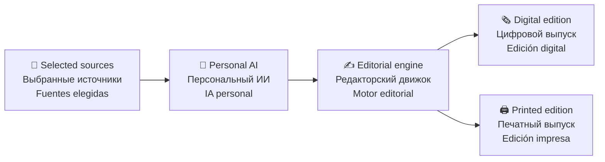

# 🗞️ You Daily

### Your world. Every morning. · Твой мир. Каждое утро. · Tu mundo. Cada mañana.

**A personal AI newspaper — made from the information you choose.**  
**Персональная ИИ-газета — из информации, которую выбираешь ты.**  
**Un periódico personal con IA — creado a partir de la información que tú eliges.**

 

*Less scrolling. More understanding.*  
*Меньше бесконечной ленты. Больше понимания.*  
*Menos desplazamiento. Más comprensión.*

---

## ✨ The vision · Идея · La visión

**EN** — You Daily turns selected parts of a person's digital world into a concise, thoughtfully edited newspaper. It may bring together messages, plans, selected news and topics of interest, then deliver the edition digitally or print it on a compact Wi-Fi printer.

**RU** — You Daily превращает выбранные части цифровой жизни человека в короткую, продуманную газету. Сообщения, планы, интересующие новости и другие источники объединяются в один выпуск, который можно читать на экране или печатать на компактном Wi-Fi-принтере.

**ES** — You Daily convierte partes seleccionadas del mundo digital de una persona en un periódico breve y cuidadosamente editado. Puede reunir mensajes, agenda, noticias y temas de interés, y entregar la edición en formato digital o imprimirla en una pequeña impresora Wi-Fi.

> 📰 **Not another feed. A newspaper that knows what matters to you.**  
> **Не ещё одна лента. Газета о том, что действительно важно тебе.**  
> **No es otro feed. Es un periódico que entiende qué te importa.**

## 🧩 How it could work · Как это может работать · Cómo podría funcionar

| Layer | English | Русский | Español |
|:--|:--|:--|:--|
| 🔐 Sources | User-selected accounts and feeds | Выбранные пользователем аккаунты и ленты | Cuentas y fuentes elegidas |
| 🧠 Intelligence | Understands, groups and prioritizes | Анализирует, объединяет и расставляет приоритеты | Analiza, agrupa y prioriza |
| ✍️ Editing | Summaries, context and layout | Сводки, контекст и оформление | Resúmenes, contexto y diseño |
| 🖨️ Delivery | Screen, PDF or scheduled print | Экран, PDF или печать по расписанию | Pantalla, PDF o impresión programada |

## 🗞️ Inside an edition · Что будет в выпуске · Qué incluirá una edición

- 💬 **Messages & follow-ups** — important items from connected inboxes and messengers.  
  **Сообщения и дела** — важное из подключённых почтовых ящиков и мессенджеров.  
  **Mensajes y tareas** — lo importante de los servicios conectados.

- 📅 **Your day** — plans, reminders and upcoming events.  
  **Твой день** — планы, напоминания и предстоящие события.  
  **Tu día** — agenda, recordatorios y próximos eventos.

- 🌍 **Selected news** — stories matched to chosen interests.  
  **Новости по интересам** — материалы на выбранные темы.  
  **Noticias seleccionadas** — temas adaptados a tus intereses.

- 🎮 **Personal topics** — technology, games, culture, communities and more.  
  **Личные темы** — технологии, игры, культура, сообщества и другое.  
  **Temas personales** — tecnología, videojuegos, cultura, comunidades y más.

- ☀️ **A daily briefing** — a short overview of what deserves attention.  
  **Главное за день** — короткая сводка того, на что стоит обратить внимание.  
  **Resumen diario** — una visión breve de lo que merece atención.

*These are planned possibilities, not claims about features already implemented.*  
*Это возможные функции, а не утверждение, что они уже реализованы.*  
*Son funciones previstas, no características que ya estén implementadas.*

## 💎 Product principles · Принципы · Principios

| Principle | EN | RU | ES |
|:--|:--|:--|:--|
| 🔒 Privacy | The user chooses what to connect and can revoke access. | Пользователь сам выбирает источники и может отключить доступ. | El usuario elige las fuentes y puede revocar el acceso. |
| 🎯 Relevance | Prioritize useful information, not volume. | Важна польза, а не количество информации. | Priorizar lo útil, no el volumen. |
| 🧾 Traceability | Summaries should link back to their sources. | У сводок должны быть ссылки на источники. | Los resúmenes deben enlazar con sus fuentes. |
| 🧠 Honesty | Separate facts, summaries and AI suggestions. | Разделять факты, пересказ и советы ИИ. | Diferenciar hechos, resúmenes y sugerencias de IA. |
| 🖨️ Readability | Design for paper as carefully as for screens. | Одинаково внимательно проектировать печать и экран. | Diseñar con el mismo cuidado para papel y pantalla. |

## 🚧 Project status · Статус · Estado del proyecto

🧪 CONCEPT & EARLY PLANNING · КОНЦЕПЦИЯ И ПЛАНИРОВАНИЕ · CONCEPTO Y PLANIFICACIÓN

**EN** — You Daily is at an early concept stage. This repository is the private project workspace. No production integrations, finished AI pipeline or printer hardware are claimed to exist yet.

**RU** — You Daily находится на раннем этапе концепции. Этот репозиторий — закрытое рабочее пространство проекта. Готовые интеграции, полноценный ИИ-конвейер и физический принтер пока не заявляются как существующие.

**ES** — You Daily se encuentra en una fase inicial de concepto. Este repositorio es el espacio privado del proyecto. Todavía no se afirma que existan integraciones de producción, un sistema completo de IA o hardware de impresión terminado.

## 🛠️ Roadmap · План · Hoja de ruta

1. 🧱 **Digital prototype** — sample content, newspaper layout and print preview.  
   **Цифровой прототип** — демонстрационные данные, макет газеты и предпросмотр печати.  
   **Prototipo digital** — contenido de muestra, diseño y vista previa de impresión.

2. 🧠 **Editorial engine** — grouping, prioritization, summaries and source references.  
   **Редакторский движок** — группировка, приоритеты, сводки и ссылки на источники.  
   **Motor editorial** — agrupación, prioridades, resúmenes y referencias.

3. 🔗 **Careful integrations** — a few official APIs with limited permissions.  
   **Аккуратные интеграции** — несколько официальных API с ограниченными разрешениями.  
   **Integraciones cuidadosas** — algunas API oficiales con permisos limitados.

4. ⏰ **Personal editions** — preferences and scheduled morning/evening delivery.  
   **Персональные выпуски** — настройки и утренняя/вечерняя доставка.  
   **Ediciones personales** — preferencias y entregas por la mañana y por la tarde.

5. 🖨️ **Print experience** — evaluate printers after the digital product proves useful.  
   **Печать** — выбор принтера после проверки пользы цифрового продукта.  
   **Experiencia de impresión** — evaluar impresoras cuando el producto digital ya aporte valor.

➡️ Full plan: [ROADMAP.md](ROADMAP.md)

## 🔐 Privacy & security · Конфиденциальность · Privacidad y seguridad

**EN** — Personal messages and account data are sensitive. Future integrations must use official authorization flows, least-privilege access, secure token storage and clear deletion controls.

**RU** — Личные сообщения и данные аккаунтов чувствительны. Будущие интеграции должны использовать официальную авторизацию, минимальные разрешения, безопасное хранение токенов и понятное удаление данных.

**ES** — Los mensajes personales y los datos de cuentas son sensibles. Las futuras integraciones deberán usar autorización oficial, permisos mínimos, almacenamiento seguro de tokens y controles claros de eliminación.

See [SECURITY.md](SECURITY.md).

## 🛡️ Project materials & rights · Материалы и права · Materiales y derechos

**EN** — This is a private repository. Project files are reserved to their rights holder unless a separate written permission or third-party license says otherwise. The general product idea is not made exclusive by this notice.

**RU** — Это приватный репозиторий. Права на материалы проекта сохраняются за правообладателем, если отдельное письменное разрешение или лицензия стороннего материала не предусматривают иное. Само по себе это уведомление не даёт исключительных прав на общую идею продукта.

**ES** — Este es un repositorio privado. Los derechos sobre los materiales del proyecto se reservan a su titular, salvo que exista un permiso escrito independiente o una licencia de terceros. Este aviso no concede exclusividad sobre la idea general del producto.

- [LICENSE](LICENSE) — usage restrictions / условия использования / condiciones de uso
- [INTELLECTUAL-PROPERTY.md](INTELLECTUAL-PROPERTY.md) — project record / история проекта / registro del proyecto
- [CONTRIBUTING.md](CONTRIBUTING.md) — contribution rules / правила участия / normas de contribución

> ⚖️ **Important / Важно / Importante:** Copyright, trademarks, patents and trade secrets protect different things. No patent or trademark registration is claimed here. Get qualified legal advice before public disclosure or commercial launch.[^1]

## 🧭 Repository map · Навигация · Índice

| File | Purpose |
|:--|:--|
| 📘 [README.md](README.md) | Product overview · О проекте · Presentación |
| ⚖️ [LICENSE](LICENSE) | Rights notice · Условия прав · Aviso de derechos |
| 🧠 [INTELLECTUAL-PROPERTY.md](INTELLECTUAL-PROPERTY.md) | IP record · Защита материалов · Registro de PI |
| 🗺️ [ROADMAP.md](ROADMAP.md) | Development plan · План разработки · Hoja de ruta |
| 🔐 [SECURITY.md](SECURITY.md) | Security principles · Безопасность · Seguridad |
| 🤝 [CONTRIBUTING.md](CONTRIBUTING.md) | Contribution rules · Правила участия · Contribuciones |

---

**🗞️ You Daily**  
*Your world. Every morning.*

**Меньше шума. Больше смысла. · Less noise. More meaning. · Menos ruido. Más sentido.**

[^1]: This repository notice is not a substitute for legal advice or formal registration. / Это уведомление не заменяет юридическую консультацию и официальную регистрацию. / Este aviso no sustituye el asesoramiento jurídico ni el registro oficial.
