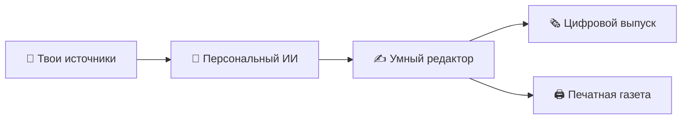
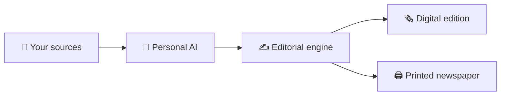
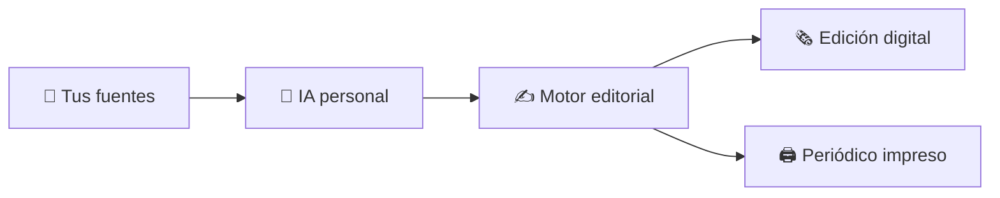

**Your world. Every morning.**

Personal AI newspaper · Персональная ИИ-газета · Periódico personal con IA

---

<strong>🇷🇺 Русский</strong> — описание проекта

# 🗞️ You Daily

### Твой мир. Каждое утро.

**You Daily** — персональная газета, которую искусственный интеллект собирает из выбранных тобой источников: сообщений, почты, календаря, новостей и интересующих тебя тем.

Вместо десятков приложений и бесконечной ленты — один красивый, структурированный выпуск. Его можно читать на экране или получать распечатанным на компактном принтере.

> 📰 **Не ещё одна лента. Газета о том, что действительно важно тебе.**

## ✨ Как это работает

1. **Подключаешь источники** — только те, которые сам выбираешь.
2. **ИИ анализирует информацию** — находит важное, объединяет похожее и расставляет приоритеты.
3. **Формируется выпуск** — кратко, понятно, с контекстом и ссылками на оригиналы.
4. **Получаешь газету** — в приложении, PDF или на бумаге.

## 🗞️ Что может попасть в выпуск

- 💬 **Сообщения** — важные письма, переписки и напоминания.
- 📅 **Твой день** — планы, события и предстоящие задачи.
- 🌍 **Новости** — события по выбранным темам.
- 🎮 **Твои интересы** — технологии, игры, культура и сообщества.
- ☀️ **Главное** — короткая сводка того, на что стоит обратить внимание.

*Это запланированные возможности, а не утверждение, что они уже реализованы.*

## 💎 Принципы продукта

| Принцип | Что это значит |
|:--|:--|
| 🔒 Приватность | Ты сам выбираешь источники и управляешь доступом. |
| 🎯 Релевантность | Меньше шума, больше действительно полезной информации. |
| 🧾 Проверяемость | Сводки сопровождаются ссылками на первоисточники. |
| 🧠 Честность ИИ | Факты, пересказ и рекомендации не смешиваются. |
| 🖨️ Читаемость | Газета должна хорошо выглядеть и на экране, и на бумаге. |

## 🚧 Текущий статус

🧪 КОНЦЕПЦИЯ И РАННЕЕ ПЛАНИРОВАНИЕ

You Daily находится на раннем этапе разработки. Сейчас формируется продуктовая концепция и планируется цифровой прототип. Готовые интеграции, полноценный ИИ-движок и физический принтер пока не заявляются как существующие.

## 🛠️ План развития

1. 🧱 Цифровой прототип и макет газеты.
2. 🧠 ИИ-редактор: группировка, приоритеты и сводки.
3. 🔗 Подключение источников через официальные API.
4. ⏰ Персональные утренние и вечерние выпуски.
5. 🖨️ Тестирование компактной автоматической печати.

➡️ [Полный план разработки](ROADMAP.md)

## 🔐 Приватность и безопасность

Личные сообщения и данные аккаунтов требуют особой защиты. Будущие интеграции должны использовать официальную авторизацию, минимальные разрешения, безопасное хранение токенов и понятные инструменты отключения и удаления данных.

Подробнее: [SECURITY.md](SECURITY.md).

## 🛡️ Материалы и права

Репозиторий приватный. Оригинальные материалы проекта предназначены для использования правообладателем. Условия использования описаны в [LICENSE](LICENSE).

- [INTELLECTUAL-PROPERTY.md](INTELLECTUAL-PROPERTY.md) — история проекта и вопросы интеллектуальной собственности.
- [CONTRIBUTING.md](CONTRIBUTING.md) — правила участия.

**Важно:** авторское право, товарные знаки, патенты и коммерческая тайна защищают разные объекты. Этот репозиторий не заявляет о наличии зарегистрированного патента или товарного знака. Общая идея продукта сама по себе не становится исключительной собственностью из-за приватности репозитория или текста лицензии.

<strong>🇬🇧 English</strong> — project overview

# 🗞️ You Daily

### Your world. Every morning.

**You Daily** is a personal newspaper created by AI from the sources you choose: messages, email, calendar, news and topics you care about.

Instead of switching between dozens of apps and endless feeds, you get one thoughtful, structured edition. Read it on a screen or have it printed by a compact printer.

> 📰 **Not another feed. A newspaper that knows what matters to you.**

## ✨ How it works

1. **Choose your sources** — connect only the services you explicitly select.
2. **AI analyzes information** — identifies what matters, groups related items and prioritizes them.
3. **An edition is created** — concise, readable and supported by context and original links.
4. **Receive your newspaper** — in the app, as a PDF or on paper.

## 🗞️ What an edition could include

- 💬 **Messages** — important emails, conversations and follow-ups.
- 📅 **Your day** — plans, events and upcoming tasks.
- 🌍 **News** — stories matching your selected interests.
- 🎮 **Personal interests** — technology, gaming, culture and communities.
- ☀️ **The briefing** — a short overview of what deserves your attention.

*These are planned possibilities, not claims about features already implemented.*

## 💎 Product principles

| Principle | What it means |
|:--|:--|
| 🔒 Privacy | You choose your sources and control access. |
| 🎯 Relevance | Less noise, more genuinely useful information. |
| 🧾 Traceability | Summaries link back to their original sources. |
| 🧠 AI honesty | Facts, summaries and suggestions stay distinguishable. |
| 🖨️ Readability | The newspaper should work beautifully on screen and on paper. |

## 🚧 Current status

🧪 CONCEPT & EARLY PLANNING

You Daily is at an early development stage. The product concept and digital prototype are being planned. No finished integrations, production AI pipeline or physical printer are claimed to exist yet.

## 🛠️ Roadmap

1. 🧱 Digital prototype and newspaper layout.
2. 🧠 AI editorial engine: grouping, prioritization and summaries.
3. 🔗 Source integrations through official APIs.
4. ⏰ Personalized morning and evening editions.
5. 🖨️ Testing scheduled printing on a compact printer.

➡️ [Full development roadmap](ROADMAP.md)

## 🔐 Privacy & security

Personal messages and account data require careful protection. Future integrations should use official authorization, least-privilege access, secure token storage and clear controls for disconnecting sources and deleting data.

Read [SECURITY.md](SECURITY.md).

## 🛡️ Project materials & rights

This repository is private. Original project materials are reserved to their rights holder. Usage terms are described in [LICENSE](LICENSE).

- [INTELLECTUAL-PROPERTY.md](INTELLECTUAL-PROPERTY.md) — project history and intellectual-property notes.
- [CONTRIBUTING.md](CONTRIBUTING.md) — contribution rules.

**Important:** copyright, trademarks, patents and trade secrets protect different things. This repository does not claim that a patent or trademark has been registered. A private repository or license notice does not make the general product idea exclusive.

<strong>🇪🇸 Español</strong> — presentación del proyecto

# 🗞️ You Daily

### Tu mundo. Cada mañana.

**You Daily** es un periódico personal creado con inteligencia artificial a partir de las fuentes que tú eliges: mensajes, correo electrónico, calendario, noticias y temas de tu interés.

En lugar de saltar entre decenas de aplicaciones y feeds interminables, recibes una edición única, clara y bien organizada. Puedes leerla en una pantalla o imprimirla con una impresora compacta.

> 📰 **No es otro feed. Es un periódico que entiende qué te importa.**

## ✨ Cómo funciona

1. **Eliges tus fuentes** — conectas únicamente los servicios que autorizas.
2. **La IA analiza la información** — identifica lo importante, agrupa contenidos relacionados y establece prioridades.
3. **Se crea una edición** — breve, clara y acompañada de contexto y enlaces originales.
4. **Recibes tu periódico** — en la aplicación, en PDF o en papel.

## 🗞️ Qué podría incluir una edición

- 💬 **Mensajes** — correos importantes, conversaciones y recordatorios.
- 📅 **Tu día** — planes, eventos y próximas tareas.
- 🌍 **Noticias** — historias relacionadas con tus intereses.
- 🎮 **Intereses personales** — tecnología, videojuegos, cultura y comunidades.
- ☀️ **Resumen diario** — una visión breve de lo que merece tu atención.

*Son posibilidades previstas, no funciones que ya estén implementadas.*

## 💎 Principios del producto

| Principio | Qué significa |
|:--|:--|
| 🔒 Privacidad | Tú eliges las fuentes y controlas el acceso. |
| 🎯 Relevancia | Menos ruido y más información realmente útil. |
| 🧾 Trazabilidad | Los resúmenes enlazan con las fuentes originales. |
| 🧠 Honestidad de la IA | Los hechos, resúmenes y sugerencias se distinguen claramente. |
| 🖨️ Legibilidad | El periódico debe verse bien tanto en pantalla como en papel. |

## 🚧 Estado actual

🧪 CONCEPTO Y PLANIFICACIÓN INICIAL

You Daily se encuentra en una fase temprana de desarrollo. Se están definiendo el concepto y el prototipo digital. Todavía no se afirma que existan integraciones terminadas, un sistema de IA de producción o una impresora física.

## 🛠️ Hoja de ruta

1. 🧱 Prototipo digital y diseño del periódico.
2. 🧠 Motor editorial con IA: agrupación, prioridades y resúmenes.
3. 🔗 Integraciones mediante API oficiales.
4. ⏰ Ediciones personalizadas por la mañana y por la tarde.
5. 🖨️ Pruebas de impresión programada con una impresora compacta.

➡️ [Hoja de ruta completa](ROADMAP.md)

## 🔐 Privacidad y seguridad

Los mensajes personales y los datos de las cuentas requieren una protección cuidadosa. Las futuras integraciones deberán utilizar autorización oficial, permisos mínimos, almacenamiento seguro de tokens y controles claros para desconectar fuentes y eliminar datos.

Consulta [SECURITY.md](SECURITY.md).

## 🛡️ Materiales y derechos del proyecto

Este repositorio es privado. Los materiales originales del proyecto están reservados a su titular. Las condiciones de uso se describen en [LICENSE](LICENSE).

- [INTELLECTUAL-PROPERTY.md](INTELLECTUAL-PROPERTY.md) — historial del proyecto y notas sobre propiedad intelectual.
- [CONTRIBUTING.md](CONTRIBUTING.md) — normas de contribución.

**Importante:** los derechos de autor, las marcas, las patentes y los secretos empresariales protegen elementos diferentes. Este repositorio no afirma que exista una patente o marca registrada. Un repositorio privado o un aviso de licencia no convierte la idea general del producto en exclusiva.

---

**🗞️ You Daily**  
*Your world. Every morning. · Твой мир. Каждое утро. · Tu mundo. Cada mañana.*

🔒 Private project · Приватный проект · Proyecto privado

